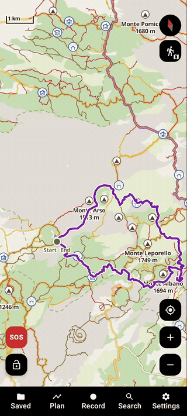
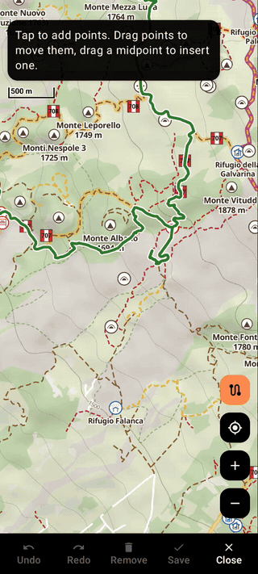
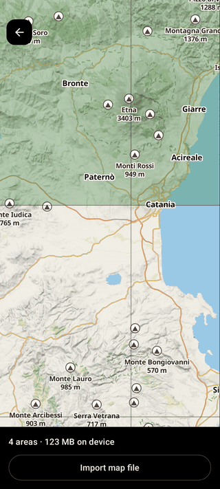
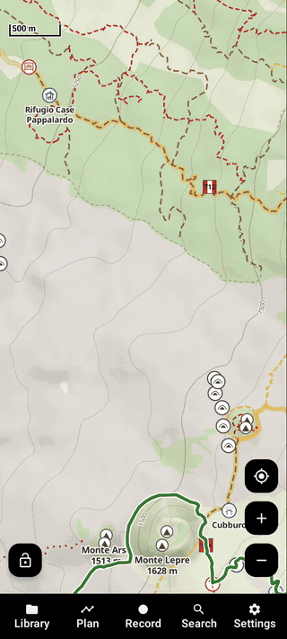
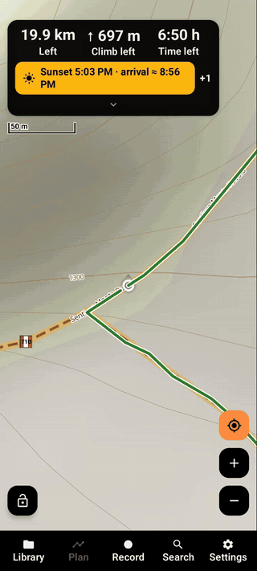

# Sentrek

Sentrek is a hiking map app for Android. You download the areas you're going to, so the map works without signal. You can plan a route on the trails, follow it, and record your walks.

It's in English and Italian, free and open source. It has no ads and no account, and it doesn't need Google Play Services.

Sentrek is heavily inspired by [Trekarta](https://github.com/andreynovikov/trekarta), one of the best open source hiking apps out there. Trekarta is sadly no longer maintained, so think of Sentrek as its spiritual successor.

The name comes from *sentiero*, Italian for trail, and *trek*.

<table>
  <tr>
    <td align="center"><br>The map</td>
    <td align="center"><br>Planning a route</td>
    <td align="center"><br>Downloading an area</td>
  </tr>
  <tr>
    <td align="center"><br>Trail info and weather</td>
    <td align="center"><br>Following a route</td>
    <td></td>
  </tr>
</table>

## Features

### Maps
- The map shows trails, marked routes with their signs, huts, springs, peaks and viewpoints. Contour lines and hill shading can be turned on in Settings › Map, and the map points turned off.
- To use it offline, download squares from a grid. A square is about 55 × 55 km and takes around 30 MB.
- Downloads carry on when you leave the app, with the progress on the map and in a notification. They wait for a connection and try again by themselves. An area is kept only once it has its map and all its details; Stop removes the ones not finished yet.
- You can colour steep slopes like an avalanche map, and colour trails by difficulty (SAC scale).
- Long-press a trail to see its difficulty and the marked routes that use it, with length, climb, walking time and who looks after them. From there you can get the weather forecast for that spot, day by day or hour by hour.
- You can also open your own `.mbtiles` and `.pmtiles` files.
- Besides hiking, there's a cycling map (waymarked cycle and mountain bike routes, cycleways) and a winter map (pistes by difficulty, cross-country and ski touring runs, lift names, in winter colours). The button under the compass switches between them and turns the map layers on and off. When you download an area you choose which of these maps it gets.

### Planning
- Tap the map to add points and the route follows the paths between them. This works offline too, in downloaded areas.
- You see distance, climb, descent, walking time and the elevation profile while you plan.
- Drag a point to move it, or drag the middle of a segment to add one. Undo and redo are there. One button turns the route around.
- Save the route, or export it as GPX or KML.

### Routes and tracks
- Add a note and photos to any route or track, as for places: water on the way, the last bus, a photo of a timetable or a junction. The note goes in the GPX file when you export it, and imported GPX files bring theirs.
- Duplicate a route to change a copy and keep the original, or make a reversed copy to walk it the other way.
- Routes shown on the map mark where they start and end, with small arrows the way they go. Where two overlap, only the top one has arrows.

### Following a route
- A card at the top shows distance left, climb left and time left. After a while the time is based on how fast you actually walk.
- Tap the card for the places coming up (huts, springs, peaks), your note on the route and the elevation profile with your position on it.
- The phone vibrates when you go off the route, and again when you're back on it.
- You can switch to walking the route the other way without stopping.
- You can import GPX, KML and KMZ files, or open them from another app.

### Recording
- It keeps recording with the screen off, and shows your stats in a notification on the lock screen.
- You can pause, and add places and photos as you go.
- Your recorded hikes add up to totals for the year and for all time.

### Warnings
The app warns you about these things, only when they apply:
- you'd finish the route after sunset
- the battery won't last to the end (one tap turns on stamina mode)
- rain, snow or storms where you're going to be
- the last spring before a long stretch with no water
- long stretches in full sun
- you've lost signal (it remembers where you last had it, so you can go back)

You can also set a turnaround alarm.

### Gloves, rain and cold
- Glove mode makes the buttons as big as they go and lets you zoom with the volume keys.
- The lock button stops rain or your pocket from pressing things.
- There's large text, dark and black themes, a night map and a full screen mode.
- Battery saver and stamina mode make the battery last longer on long days. Stamina mode can turn itself on at a battery level you pick.
- Even without them, the map only draws at full speed while you touch it, and the GPS slows down while you're only looking at the map.

### Safety
- A red SOS button on the map opens a screen with your position in big text (coordinates, UTM and Plus Code), with buttons to call for help and to send your position by SMS to your emergency contact. It asks first, then sends the text itself.
- It can send your position by SMS to someone every 30 or 60 minutes while you record. SMS works without mobile data.
- "Peaks around" tells you the names of the mountains you can see.

### Search
- One search box for your places and tracks, and the towns, peaks, lakes, huts, springs and other named points of the downloaded areas. It works offline.
- Paste coordinates (from a text message, say) and it takes you there.

### Your own servers
Sentrek gets its data from free public services, so it doesn't depend on a server of mine. If one of them shuts down or changes its rules, you can host your own copy and point the app to it in Settings › Advanced › Servers. This works for:
- map tiles (any server in the OpenFreeMap format)
- terrain (Terrarium elevation tiles)
- trail details (any Overpass API server)

## Privacy

Everything you save (tracks, routes, places, photos) stays on your phone. You can back it up to a file from the settings.

The app only goes online to:
- load map and terrain tiles
- get trail details (and pistes or cycle routes, if you pick those maps) for the areas you download
- get the weather forecast, if you turn it on

There's no tracking or analytics of any kind.

## Install

You need Android 7.0 or newer.

Download the APK from the [Releases](../../releases) page. The `arm64` file is the right one for nearly every phone, and `armv7` is for older 32-bit phones. If neither installs, use the `universal` one, which is bigger but works on any device.

## Building

See [BUILDING.md](BUILDING.md). You need JDK 17 or newer and the Android SDK. Then:

```sh
git clone https://github.com/Fef0/Sentrek.git
cd Sentrek
./gradlew assembleDebug
```

## Data sources

- Map data © [OpenStreetMap](https://www.openstreetmap.org/copyright) contributors, under the Open Database License
- Vector tiles: [OpenFreeMap](https://openfreemap.org/), [OpenMapTiles](https://openmaptiles.org/) schema
- Terrain: Mapzen terrain tiles on [AWS Open Data](https://registry.opendata.aws/terrain-tiles/)
- Trail details: [Overpass API](https://overpass-api.de/) (FOSSGIS, VK Maps, private.coffee)
- Weather: [Open-Meteo](https://open-meteo.com/)
- Map icons: [OpenStreetMap Carto](https://github.com/gravitystorm/openstreetmap-carto) (CC0)
- Map rendering: [MapLibre Native](https://github.com/maplibre/maplibre-native)

## Contributing

Bug reports and ideas are welcome in the issues. Translations too: [TRANSLATING.md](TRANSLATING.md) explains how to add a language, no code needed. Please say which phone and Android version you have, and which Sentrek version (Settings › About). If you want to work on something big, open an issue first so we can talk about it.

## License

[GNU GPL v3.0](LICENSE)
